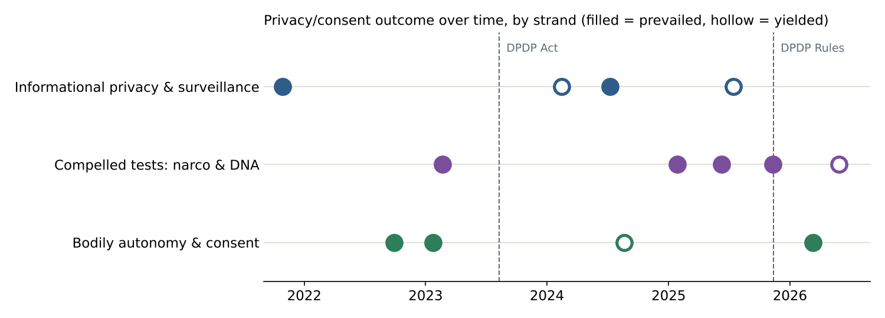
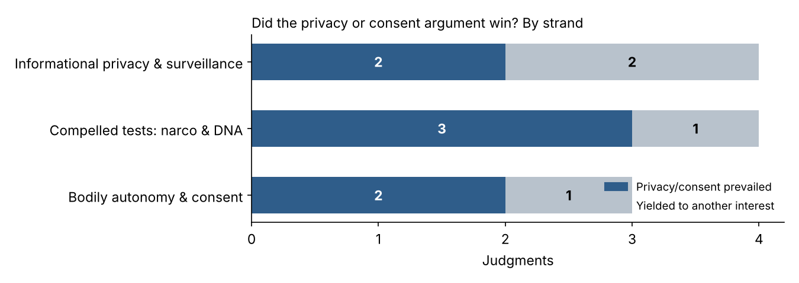
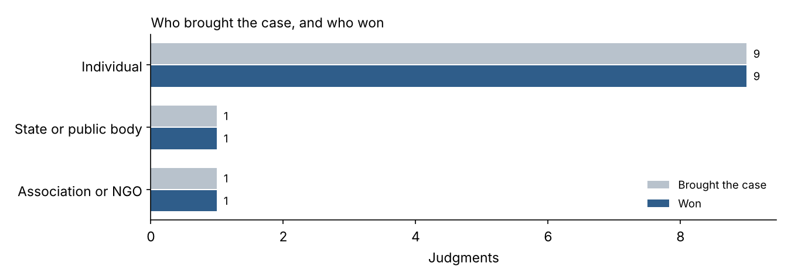

# Consent and informational privacy in the Supreme Court of India, 2021 to 2026

**Live page:** see the GitHub Pages link in this repository's About section.

## Team

- Astitva Agrawal, Division C
- Anmol Kumar Sinha, Division C
- Sahil Islam, Division D
- Khushi Gurm, Division B

## Topic

We study when the Supreme Court lets a person's consent, or their control over their body and personal information, win against the State, a family member or the public's right to know. The question matters because the Digital Personal Data Protection Act, 2023 makes consent the default basis for processing personal data. We wanted to see what the Court itself has been saying about consent since *Puttaswamy*, while the Act was being drafted, passed and brought into force.

## How we found the judgments

We searched Indian Kanoon, LiveLaw and Supreme Court Observer for "right to privacy", "informational privacy", "consent", "narco-analysis", "DNA test" and "Article 21", limited to Supreme Court decisions between 1 September 2021 and 31 August 2026. We did not keep exact result counts. The privacy searches return hundreds of judgments, most of which mention privacy only in passing. We kept a judgment only if it was a reasoned decision and a privacy or consent argument was central to the result. Each case was then confirmed on the Court's own website (sci.gov.in or Digital SCR), and the official copy is linked in `data.csv`. That gave 11 judgments.

Besides the template columns, we gave each judgment two labels of our own. The first is a **strand**: informational privacy & surveillance, compelled tests (narco & DNA), or bodily autonomy & consent. The second records whether the **privacy or consent argument prevailed** or yielded to another interest.

## What the data shows

**Over time.** Before the DPDP Act was passed in August 2023, the privacy or consent argument won all three judgments in our set. After it, the record is split four to four. The losses are not wins for State power. Each came where privacy met another person's right: voters' right to know (electoral bonds), a child victim (POCSO), a spouse proving cruelty, and a son seeking his paternity. What surprised us most was the DNA line. *Aparna Firodia* (2023) treated DNA tests of children as a near-bar, and *R. Rajendran* (2025) added a proportionality test. Then *Chaturbhuj Pradhan* (2026) relied on both cases to actually order a test.

**By strand.** Privacy or consent prevailed in 7 of 11 judgments. Compelled tests are the strongest strand (3 of 4). *Amlesh Kumar* (2025) restated *Selvi*: a forced narco test is never permissible. Informational privacy is split two and two. That did not surprise us, because both losses set privacy against another person's right to information or to prove a case.

**Who won.** Individuals brought 9 of the 11 cases and won 9. The State's only win, in the POCSO adolescents case, rested on protecting a child, not on any power to intrude. We expected the State to appear more often as a winner. Instead, in the electoral bonds case the State relied on donor privacy and lost.

## The doctrinal trend in one paragraph

Consent works almost as a trump against direct State coercion: narco tests, location tracking on bail, spyware. Against other people's rights it is weighed under a proportionality test. The DPDP Act's "legitimate uses" let the State and others process data without consent. The case law suggests courts will police that strictly where the State reaches into a person's body or phone, and will balance it elsewhere. None of the 11 judgments turns on the DPDP Act, so how courts will apply that law is still untested.

## Limits

Eleven judgments from one court cannot show a statistical trend, and our set is a selection of cases where privacy was central, not every case that mentions it. The strand labels and the "prevailed" coding are our own judgment calls. The Supreme Court mostly hears appeals, so the set says nothing about High Courts or the Data Protection Board.

## AI-use disclosure

We used Claude (Anthropic) to help build the web page and charts, draft the one-line issue and holding summaries, and check our dataset against the official copies. That check found two judgments we had wrongly coded as narco-analysis cases. *Manoj Kumar Soni* (2023) and *Vinobhai* (2025) are in fact about s 27 Evidence Act disclosure statements, so we removed them and added two DNA-testing judgments. For every judgment, the team member named in the "Coded by" column read the official copy and checked the case name, citation, date, bench, outcome, provision and the one-line summaries against it.

## Files

- `index.html`: analysis and visualisation page (published with GitHub Pages)
- `data.xlsx`: completed Dataset template
- `data.csv`: the Data sheet as CSV
- `chart1-over-time.png`, `chart2-by-strand.png`, `chart3-who-won.png`: charts used above
